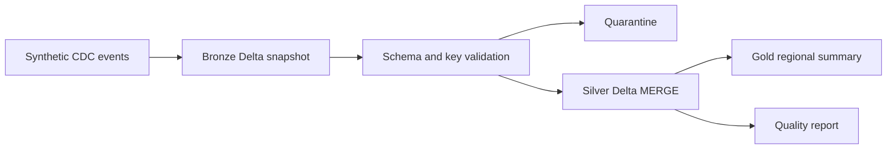

# Config Driven Lakehouse

[](https://github.com/jairajvk07/config-driven-lakehouse/actions/workflows/tests.yml)

A PySpark and Delta Lake pipeline for processing customer changes into Bronze, Silver, and Gold tables. Configuration controls the input, primary key, source sequence, operations, and output location.

## Architecture



## Design decisions

- Source sequence controls ordering within each customer key.
- Silver retains deletion tombstones, so older events cannot resurrect deleted customers.
- Only newer changes update an existing key. Replaying the same file is idempotent.
- Conflicting payloads for one key and sequence fail the run instead of selecting an arbitrary result.
- Invalid keys, sequences, and operations go to a separate quarantine table.

## Quick start

Requires Python 3.10 or 3.11 and Java 17 with JAVA_HOME configured. Run from this directory. Linux, macOS, or WSL2 is recommended. The first run downloads Delta JVM dependencies.

```sh
python -m venv .venv
# Activate .venv for your shell, then:
python -m pip install -r requirements.txt
python pipeline.py --config config.json
```

The six synthetic events include an update, a deletion, and an invalid key. Expected output is two active customers (East and West) and one quarantined event. Inspect the Delta tables under `output/lakehouse/` and the counts in `output/lakehouse/quality.json`.

## Tests

```sh
python -m unittest discover -v
RUN_SPARK_TESTS=1 python -m unittest discover -v
```

In PowerShell, set `$env:RUN_SPARK_TESTS='1'` before the second command. The fixture test checks coverage of update, deletion, and invalid-key cases. The integration test runs the actual Delta pipeline, repeats ingestion, and verifies that a stale insert does not undo a later deletion. GitHub Actions runs both checks with Java 17.

## Configuration

| Field | Meaning |
| --- | --- |
| source | Input JSONL file |
| root | Output root for all Delta tables and the report |
| key | Primary customer key |
| sequence | Monotonic source version per key |
| allowed_ops | Supported insert, update, and delete operations |

The explicit input schema is customer ID, source sequence, operation, name, and region. Column types are intentionally fixed; automatic schema evolution is out of scope.

## Deployment and limitations

This is a portfolio demonstration using synthetic data. Bronze replaces the demo input snapshot on each run; it is not a durable ingestion ledger. The source is re-read in full rather than managed with a production connector cursor. Do not delete tombstones until the upstream replay window makes that safe.

For Databricks, use a compatible Delta-enabled runtime, remove the local session/package bootstrap, configure governed cloud-storage paths, and schedule the job. Production use also requires source cursors, schema contracts, secret-managed connections, retention policies, alerts, and scale tests. No employer code, private data, or production throughput claims are included.

## Files

`pipeline.py` — ingestion, CDC merge, quality checks, and reporting.  
`config.json` — runtime configuration.  
`sample_cdc.jsonl` — synthetic changes.  
`test_project.py` — fixture and runtime integration tests.

[Portfolio](https://jairajvk07.github.io/)
